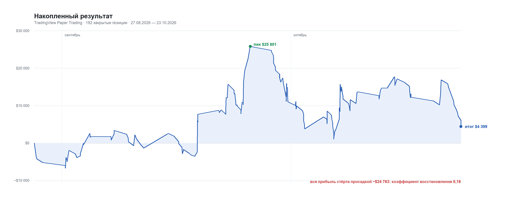
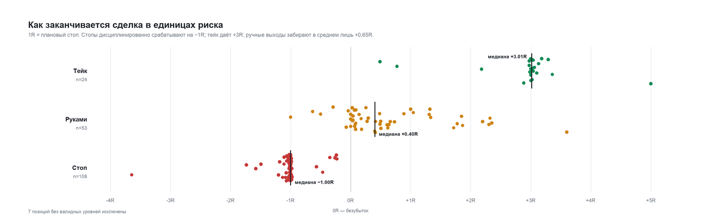

# TradingView Paper Trading: разбор 192 сделок

**Период:** 27.08.2026 — 23.10.2026 (8 недель, 40 торговых дней)
**Счёт:** TradingView · Paper Trading (`tradingview:7f5049e712b0a93c14496453`)
**Источник:** 194 импортированные позиции из приложения, 192 закрыты, 2 открыты
**Валюта:** USD, комиссия 0 (бумажный счёт)

---

## Главное в пяти строках

1. **+$4 399 за 8 недель — это статистический ноль.** Profit factor 1,04, матожидание +$23 на сделку при разбросе $1 657, t-статистика 0,19. Такой результат неотличим от случайного.
2. **Вся прибыль — 8 сделок по газу с удержанием дольше 4 часов** (+$28 844, 7 из 8 в плюс). Остальные 184 сделки дали **−$24 445**.
3. **Экономика ровно на границе безубытка.** Винрейт 37,5%, средняя прибыль / средний убыток = 1,69. Точка безубытка при таком винрейте — 1,67.
4. **Главная утечка — ручные выходы.** 60 сделок закрыты руками, медиана **+0,40R** при плане **3R**. Половина из них закрыта в плюсе, не дойдя даже до +1R.
5. **Просадка съела всё.** Пик +$25 801, максимальная просадка −$24 763, итог +$4 399. Коэффициент восстановления 0,18.



---

## 1. Паспорт выборки

| Параметр | Значение |
|---|---|
| Закрытых позиций | 192 (+2 открыты) |
| Торговых дней | 40 (в среднем 4,8 сделки в день) |
| Инструментов | 18 контрактов, 7 основных семейств (NG, BR, GD, MX, CR, SV, SI) |
| Лонг / шорт | 91 / 101 |
| Комиссия | $0 — бумажный счёт, реальные издержки не учтены |
| Позиций с планом в журнале | 192 из 192 |
| Позиций с текстом разбора | 178 |

Всё считается по данным приложения: `imported_positions` + уровни планов из `plans`/`plan_positions`, причина выхода — по `assess_exit` из `backend/domain/journal.py`. То есть цифры совпадают с тем, что показывает раздел «Отчёт торговли».

---

## 2. Базовые метрики

| Метрика | Значение | Комментарий |
|---|---|---|
| Чистый результат | **+$4 398,59** | gross = net, комиссии нет |
| Винрейт | **37,5%** | 72 прибыльных, 117 убыточных, 3 в ноль |
| Чистый винрейт (тейки / тейки+стопы) | **18,2%** | 24 тейка против 108 стопов |
| Средняя прибыль | $1 658 | |
| Средний убыток | $983 | |
| Соотношение прибыль/убыток | **1,69** | нужно ≥1,67 при винрейте 37,5% |
| Profit factor | **1,04** | |
| Матожидание на сделку | **+$22,9** | при σ = $1 657 |
| t-статистика | **0,19** | значимого преимущества нет |
| Медианный результат сделки | **−$676** | типичная сделка убыточна; средний плюс держат несколько крупных выигрышей |
| Лучшая / худшая сделка | +$8 160 / −$4 080 | |
| Максимальная просадка | **−$24 763** | от пика $25 801 |
| Восстановление (net / maxDD) | **0,18** | |
| Макс. серия убытков | 6 | макс. серия прибылей — 10 |
| Медианный плановый риск | $999 (p25–p75: $960–1 012) | 171 из 185 ≤ $1 500 |

По месяцам:

| Месяц | Сделок | Результат | Винрейт |
|---|---|---|---|
| Август 2026 | 5 | −$5 203 | 20,0% |
| Сентябрь 2026 | 103 | +$16 221 | 41,7% |
| Октябрь 2026 | 84 | −$6 619 | 33,3% |

Сентябрь — это и есть вся прибыль. Август — разгон, октябрь — отдача.

---

## 3. Сильные стороны

### 3.1. Риск на сделку почти всегда один и тот же

Медианный риск **$999**, межквартильный коридор **$960–1 012**. Из 185 измеримых позиций **171 (92%)** укладываются в $1 500, а 127 — в узкий коридор $900–1 100. Это самая недооценённая вещь в вашей торговле: вы не «увеличиваете ставку, когда прёт» и не режете её после убытка.

Выбиваются 9 сделок с риском $3 000–6 200 и одна сломанная запись (`NGX`, стоп 2,5 при входе 3,397 — 26% дистанции, почти наверняка опечатка, риск $107 773). То есть риск-менеджмент выдержан примерно в 90% книги, а оставшиеся 10% — это либо осознанно увеличенный размер, либо ошибки в уровнях.

### 3.2. Асимметрия прибыли есть

Средняя прибыль $1 658 против $983 убытка. 35 сделок дали больше +1R, 27 — больше +2R, 15 — больше +3R. Хвост справа реален: лучшие сделки +8,2R и +7,3R.

### 3.3. Убытки короткие, прибыль длинная

| | Среднее | Медиана |
|---|---|---|
| Удержание прибыльных | 12,5 ч | 183 мин |
| Удержание убыточных | 4,6 ч | 75 мин |

Это правильная асимметрия: вы не сидите в минусе, надеясь на разворот. Медианный убыток закрывается за 75 минут.

### 3.4. Нет мстительной торговли

После убытка возврат в **тот же** инструмент происходит медианно через **11 часов**; быстрее 30 минут — только 15 случаев из 107. Разворот направления сразу после стопа — 8 из 33 быстрых возвратов (24%). Это не тильт.

### 3.5. Нет перегруза портфеля

Максимум 5 одновременных позиций, 84% времени — не больше двух, средневзвешенно 1,08. Кластерного риска нет: даже в худший день вы не держали пять позиций по $1 000 одновременно.

### 3.6. Журнал ведётся регулярно

214 заметок написаны с 7 августа по 18 октября — **в процессе торговли**, а не одним залпом в конце. Медианная задержка между выходом и разбором — **3 дня**, 37 из 178 записаны в день выхода или на следующий. У 232 планов есть тезис, у 221 — текст разбора.

И текст содержательный: уровни, фибоначчи, объёмы, дивергенции, конкретные уровни входа. Это редкость — обычно в дневниках пишут «вошёл по тренду».

### 3.7. Вы честно называете свои ошибки

Частота формулировок в 194 разборах:

| Формулировка | Раз |
|---|---|
| «шпилька» (выбило проколом) | 18 |
| «зря» | 11 |
| «ошибка» / «ошибся» | 10 |
| «зассал» / «забоялся» | 7 |
| «вынесло» | 5 |
| «не рассчитал» | 3 |
| «увеличил ставки» | 1 |

Это те же проблемы, что видны в цифрах. Самодиагностика у вас точнее, чем у большинства.

### 3.8. Симметрия лонг/шорт

91 лонг (+$991) и 101 шорт (+$3 408) — обе стороны около нуля. Структурного перекоса в сторону одного направления нет.

### 3.9. Есть один сегмент с настоящим преимуществом

Газ с удержанием дольше 4 часов: **8 сделок, +$28 844, 7 из 8 в плюс, t = 3,78**. Пять из восьми закрыты ровно на +3R — это признак механического тейка, который вы не трогали руками. Подробнее в разделе 6.

---

## 4. Слабые стороны

### 4.1. Преимущества нет — и это главное

t = 0,19. Чтобы 95%-интервал для среднего результата перестал включать ноль при таком разбросе ($1 657 на сделку), нужно около **20 000 сделок**. Либо преимущества нет, либо оно слишком мало относительно шума.

Медианная сделка при этом **убыточна** (−$676). Средний плюс держится на нескольких крупных выигрышах — это хрупкая конструкция.

### 4.2. Результат держится на трёх сделках

| | Сумма | Доля от итога |
|---|---|---|
| Топ-3 сделки | +$19 092 | 434% |
| Без топ-3 | **−$14 693** | |
| Топ-10 | +$40 970 | 931% |

Уберите три сделки — и книга убыточна на $14,7k. Это не «стабильная торговля», это три удачных эпизода.

### 4.3. Почти всё, кроме газа, — минус

| Семейство | Сделок | Результат |
|---|---|---|
| **NG · газ** | 17 | **+$26 519** |
| SV · серебро | 23 | +$987 |
| MX · индекс | 39 | −$322 |
| SI · доллар | 9 | −$2 620 |
| CR · юань | 11 | −$4 479 |
| GD · золото | 42 | −$7 048 |
| BR · Brent | 47 | −$9 159 |

Вы торгуете 175 сделок вне газа и теряете на них $22,1k. Газ — единственное, что это компенсирует.

### 4.4. Ручной выход превращает 3R в 0,4R



| Тип выхода | Сделок | Результат | Медиана R |
|---|---|---|---|
| Тейк | 24 | +$68 477 | **+3,01R** |
| Руками | 60 | +$46 387 | **+0,40R** |
| Стоп | 108 | −$110 465 | **−1,00R** |

Технически ручные выходы в плюсе (+$46k), но экономически они стоят дороже, чем приносят: 53 измеримых ручных выхода дали медианно +0,40R там, где план предполагал +3R. **30 из 53 закрыты в плюсе, не дойдя до +1R.**

Ваши же заметки: «закрыл руками так как цена не дошла до цели 13 копеек и развернулась», «зассал переходить через ночь», «зря ждал».

Справедливости ради: часть ручных выходов спасала от стопа — в заметках есть «до тейка бы не дошло всё равно». Поэтому это не чистый минус 2,6R на сделку. Но правило «выхожу на 0,4R, когда план был 3R» математически не может работать долго: при таком исполнении нужен винрейт 71%.

### 4.5. Стопы стоят внутри шума

Медианная дистанция стопа — **0,36%** от цены входа, тейка — 1,04%. Для фьючерсов на Brent, золото и индекс это очень узко.

- **23 стопа** выбиты в первые **15 минут** после входа
- **33 стопа** — в первые 30 минут
- 18 раз вы сами пишете «шпилька»

Вы ставите стоп на технический уровень, но слишком близко к цене входа, и его снимает обычный шум. У 76% стопов записанный уровень совпадает с ценой выхода с точностью до 0,01% — то есть постфактум вы фиксируете «вот здесь меня выбило», а не «здесь стоял мой ордер».

### 4.6. Экономика на границе

При винрейте 37,5% безубыточный коэффициент прибыль/убыток = (1 − 0,375) / 0,375 = **1,67**. У вас **1,69**. Запас — 1%. Любое ухудшение исполнения, комиссия или проскальзывание уводит в минус. На реальном счёте с комиссией эта книга была бы убыточной.

Чтобы при том же винрейте получить PF 1,3, средняя прибыль должна вырасти с 1,69R до **2,17R**.

### 4.7. Время входа: 11–13 часов

| Часы входа | Сделок | Результат |
|---|---|---|
| 11:00–13:00 | 60 | **−$23 133** |
| в т.ч. 13:00 | 21 | **−$14 895** |
| 18:00–22:00 | 44 | +$12 719 |
| 10:00 | 20 | +$5 457 |
| 14:00 | 9 | +$5 948 |

Полдень — худшее время дня. Осторожно: t = −2,39 при 21 сделке, это скорее наводка, чем доказанный факт (см. раздел 5).

### 4.8. Среда

| День | Сделок | Результат |
|---|---|---|
| Понедельник | 36 | +$8 408 |
| Вторник | 37 | +$15 464 |
| **Среда** | 51 | **−$19 050** |
| Четверг | 40 | +$3 963 |
| Пятница | 28 | −$4 385 |

Среда — единственный день, который тянет книгу вниз. t = −2,24, но это всего 5 сред, и одна из них (+$8 412) сильно положительная.

### 4.9. Всё, что короче часа, — минус

| Время в позиции | Сделок | Результат |
|---|---|---|
| < 15 мин | 36 | −$11 959 |
| 15–60 мин | 37 | −$5 378 |
| 1–4 ч | 57 | −$6 268 |
| **4–24 ч** | 52 | **+$9 107** |
| **> 1 дня** | 10 | **+$18 896** |

Скальпинг и внутридневная возня дают −$17,3k на 73 сделках. Деньги — в удержании.

### 4.10. Журнал описывает, а не предписывает

Это самое важное ограничение, и оно бьёт по всем метрикам выше.

- Уровни записаны **после** сделки: медианная задержка разбора — 3 дня.
- У **82 из 108** «стопов» записанный стоп совпадает с ценой выхода с точностью до 0,01% (в 61 случае — до цента).
- У 12 из 24 «тейков» — то же самое.

Вывод: «чистый винрейт 18,2%» и разбивка «стопы/тейки/руками» — это **ваша интерпретация задним числом**, а не запись выставленных ордеров. По этим данным нельзя доказать, что стоп ставился заранее. Приложение считает причину выхода по уровням, которые вы вписали после факта, — и это завышает дисциплину.

### 4.11. Ошибки в уровнях

- **6 планов** со стопом и тейком по одну сторону от входа (перепутаны местами или опечатка).
- **4 плана** вообще без уровней.
- Итог: 8 позиций (4,2%) в отчёте попадают в «Не определено».

Примеры: `RUS:CRZ2026 · Лонг 22.10` — вход 12,334, стоп 12,394, тейк 12,304 (для лонга стоп выше входа, тейк ниже). `RUS:NGU2026 · Шорт 24.09` — стоп 2,988, тейк 3,088, вход 3,064.

### 4.12. Ошибка в приложении, которая портит классификацию

`backend/domain/journal.py`, `assess_exit`: дистанция стопа считается от **планового** входа (`entry_zone`), а движение цены — от **фактического**. Когда вход далеко от плановой зоны, классификация ломается.

Затронуто **6 позиций**: например, шорт BRX с плановым входом 113,77, стопом 114,27 и фактическим входом 113,11 закрылся по 113,65 — до стопа цена не дошла, но сделка помечена «Стоп». Все шесть — убыточные, все шесть попали в статистику стопов.

Это надо чинить: либо обе величины от фактического входа, либо обе от планового.

### 4.13. Пустые поля эмоций и выводов

`position_notes` содержит поля `emotions` и `lessons`, но **0 из 214** записей их заполняют — интерфейс их скрывает (поле `exit_reason` тоже пустое во всех 214). А это ровно те данные, которых не хватает для разбора 4.4: почему вы вышли на 0,4R.

---

## 5. Что здесь может быть случайностью

Честный разбор обязан отделить закономерности от шума. Эффективная выборка — **40 торговых дней**, а не 192 независимых наблюдения: сделки внутри дня и внутри серии сильно коррелированы.

| Срез | n | Средний результат | t | Вердикт |
|---|---|---|---|---|
| Все сделки | 192 | +$23 | 0,19 | преимущества не видно |
| NG и удержание >4 ч | 8 | +$3 606 | **3,78** | самый сильный сигнал |
| NG, удержание ≤4 ч | 9 | −$258 | −0,39 | газа самого по себе недостаточно |
| Не NG, удержание >4 ч | 54 | −$16 | −0,07 | ноль |
| Не NG, удержание ≤4 ч | 121 | −$176 | −1,62 | устойчиво отрицательно |
| Вход 13:00 | 21 | −$709 | −2,39 | наводка |
| Среда | 51 | −$374 | −2,24 | наводка |
| Удержание <1 ч | 73 | −$238 | −1,72 | наводка |
| Brent + юань | 58 | −$235 | −1,26 | наводка |
| Октябрь | 84 | −$79 | −0,45 | не значимо |

Как это читать:

- **NG > 4 ч** — единственный срез, который проходит строгий тест. Но это 8 сделок, и 5 из них — один и тот же тейк +3R. То есть проверяется не «газ», а один конкретный сетап.
- **Не NG ≤ 4 ч** — 121 сделка, средний минус. Здесь n большой, и вывод устойчивее: эта деятельность стабильно убыточна.
- Всё остальное (среда, 13:00, короткие удержания) — корреляции на маленьких выборках. Их можно использовать как фильтр для проверки, но нельзя превращать в догму. Легко подогнать правило под 5 сред.

Разница между «+$4 399 за 8 недель» и «−$14 693 без трёх сделок» — это разница между торговлей и везением. Пока данных хватает только на второе.

---

## 6. Куда смотреть

### 6.1. Один сегмент, где вы зарабатываете

```
Газ (NG) И удержание дольше 4 часов
→ 8 сделок, +$28 844, винрейт 87,5%, t = 3,78
→ 5 из 8 закрыты ровно на +3R
→ остальные 184 сделки: −$24 445
```

Ключевое: газ с удержанием **меньше** 4 часов даёт −$2 325 на 9 сделках. Значит, преимущество не в инструменте, а в **сетапе + удержании**. Вы умеете держать позицию по газу, когда у неё есть запас хода, — и это единственное место, где вы не мешаете себе руками.

Даты этих сделок: 01.09, 02.09, 03.09, 08.09, 22.09, 24.09, 28.09, 12.10. Разбросаны по всему периоду, не одна удачная неделя.

### 6.2. Метрики, за которыми следить (и где их брать в приложении)

| Метрика | Сейчас | Цель | Где смотреть |
|---|---|---|---|
| Медианный R ручных выходов | +0,40R | **> 1,0R** | считается вручную по стопам |
| Доля сделок, дошедших до тейка | 12,5% | **> 20%** | «Отчёт торговли» → Тейки / Позиций |
| Чистый винрейт | 18,2% | рост | «Отчёт торговли» |
| Средний риск на сделку | $999 | держать $900–1 100 | вычислить по стопам |
| Доля сделок вне NG | 175 / 192 | **< 50%** | «Торговля» → фильтр «Только инструмент» |
| Доля удержаний < 1 ч | 73 / 192 | **< 30%** | нет колонки, нужен расчёт |

В приложении уже есть всё для трёх из шести: **«Отчёт торговли» → «По дням»**, фильтры по счёту и тикеру, колонки «Тейки / Стопы / Ручные / Не определено» и два винрейта.

**Что стоит смотреть каждую неделю:**
1. «Отчёт торговли» → «По дням» → все дни хуже −$2 000. Их было 5: 22.10 (−$7 687), 28.09 (−$6 424), 02.10 (−$6 130), 23.09 (−$5 804), 30.09 (−$5 240). На них приходится −$31,3k, то есть больше, чем весь итог.
2. «Торговля» с фильтром «Только инструмент» = NG против «Исключить инструмент» = NG. Два числа, разница между которыми — вся ваша прибыль.
3. Колонка «Причина выхода»: соотношение «Ручные» к «Тейки». Сейчас 60 к 24. Это самый быстрый индикатор того, вернулась ли привычка вмешиваться.
4. «Дневник» → вкладка «Без плана» — сколько позиций осталось без разбора.

### 6.3. Что проверить в первую очередь

Три вопроса, на которые у меня нет ответа по этим данным, но которые решают всё:

1. **Почему вы выходите на 0,4R?** Страх отдать прибыль, необходимость освободить маржу, или отсутствие заранее выставленного тейка? Ответ определяет лечение.
2. **Почему стопы стоят на 0,36%?** Вы ставите их по техническому уровню (тогда проблема в выборе уровня) или «чтобы риск был $1 000» (тогда проблема в размере позиции)?
3. **Сделки по газу >4 ч — это один и тот же сетап?** Если да, у вас есть система, и её надо докручивать. Если нет — это 8 совпадений.

---

## 7. Куда идти

Порядок важен: сначала перестать терять, потом наращивать. Сейчас вы зарабатываете в одном сегменте и отдаёте в остальных.

### Шаг 1. Убрать руку с кнопки (1–2 недели)

**Правило:** стоп и тейк выставляются одновременно со входом, руками не трогаются.

Основание: пять из восьми прибыльных сделок по газу закрыты ровно на +3R — там, где стоял механический тейк. 60 ручных выходов дали медианно +0,4R. Один и тот же трейдер, два разных результата — разница только в наличии ордера.

**Метрика успеха:** медианный R ручных выходов. Если через 20 сделок он ниже +1,0R — правило не работает, меняем.

**Что делать с соблазном:** если хочется выйти раньше — фиксируйте **половину** позиции, а вторую ведите по стопу в безубыток. Это оставляет +1,5R вместо +0,4R при том же ощущении контроля.

### Шаг 2. Расширить стоп, уменьшить объём (сразу)

Медианный стоп 0,36% — это внутри шума; 23 стопа выбиты за 15 минут. Ставьте стоп за технический уровень, а не «на $1 000 риска», и **уменьшайте объём** так, чтобы риск остался $1 000.

Формула: `объём = риск / (дистанция стопа в пунктах × стоимость пункта)`.

При стопе 0,7% вместо 0,36% объём падает вдвое, риск тот же, а доля выбитых шумом стопов должна упасть. Проверять по колонке «Стопы»: цель — с 56% до 45%.

### Шаг 3. Сузить вселенную (2–4 недели)

175 сделок вне газа дали −$22,1k. Не «торгуйте только газ» — это подгонка под 8 сделок. Но:

- **Разрешить полный размер** только по NG со сетапом, который отработал 8 раз.
- **Остальные инструменты — уменьшенным размером** (0,25R вместо 1R) до тех пор, пока не наберётся 30 сделок со статистикой.

Так вы не запрещаете себе торговать, но платите за исследование вчетверо меньше.

### Шаг 4. Вернуть журнал на своё место (сразу)

Сейчас разбор пишется медианно через 3 дня после выхода и содержит уровни, восстановленные по факту. Нужно наоборот:

1. **До входа:** создать план, указать `entry_zone`, `planned_stop`, `planned_take`, `planned_for`.
2. **После выхода:** только текст разбора, уровни не менять.

Тогда «чистый винрейт» станет измерением, а не интерпретацией. Пока это не сделано, не используйте 18,2% как KPI — число не значит того, что кажется.

### Шаг 5. Дневной лимит потерь

Худший день −$7,7k — это 7,7R. Пять дней хуже −$2 000 сложились в −$31k. Правило «−3R за день → стоп до завтра» отрезало бы большую часть этого.

Это не про статистику (её тут нет), это про то, что просадка −$24,8k при итоге +$4,4k — цена, которую вы уже заплатили.

### Чего НЕ делать

- **Не увеличивать размер.** При t = 0,19 увеличение ставки увеличивает шум, а не прибыль. Сначала преимущество, потом размер.
- **Не добавлять инструменты.** У вас уже 7 семейств; проблема не в охвате, а в отборе.
- **Не строить правила на среде и 13:00.** 5 сред и 21 сделка — этого мало. Держите как наблюдение, проверяйте на новых данных.

---

## 8. Что поправить в приложении

По ходу разбора нашлось четыре вещи, которые мешают вам видеть свою торговлю:

1. **Баг в `assess_exit`** (`backend/domain/journal.py`): дистанция от планового входа, движение — от фактического. 6 позиций помечены стопом, хотя цена до стопа не дошла. Чинится в одном месте: обе величины считать от `actual_entry` (или обе от `planned_entry`).

2. **Нет R-мультипликатора.** У приложения уже есть `planned_stop` и `entry_price` — добавить колонку «Риск, R» и «Результат, R» в таблицу позиций. Это превращает список сделок в измеримую систему; без R вы видите доллары, но не видите качество решений.

3. **Нет пометки «план создан после выхода».** Сравнить `plans.created_at` и `positions.exit_at` и показывать предупреждение в карточке. Это автоматически отделит настоящие планы от реконструкции.

4. **Поля `emotions` / `lessons` скрыты и пусты.** Именно там должен жить ответ на вопрос «почему вышел на 0,4R». Стоит вернуть хотя бы одно поле — «почему вышел».

---

## Ограничения анализа

- **Только TradingView.** В базе есть ещё 192 позиции по счетам Т-Банка (2023–2026, 1 905 исполнений) — они не разбирались. Сравнение двух книг было бы полезнее любой из них по отдельности.
- **Бумажный счёт.** Комиссия и проскальзывание равны нулю. На реальном счёте PF 1,04 гарантированно превратится в убыток.
- **Нет ценового ряда.** Нельзя измерить, сколько вы недобрали на каждом выходе (MFE), — только гадать по заметкам. Поэтому вывод про 0,4R против 3R — про **фактическое исполнение**, а не про упущенную прибыль.
- **Уровни восстановлены постфактум.** Все R-оценки опираются на уровни, записанные после сделки. Они отражают ваши намерения, но не доказывают, что ордера стояли.
- **Выборка.** 192 сделки, 40 дней, вся прибыль в 3 сделках. Любой вывод здесь — гипотеза для проверки, а не факт.

---

*Отчёт построен по данным `trade_activity.sqlite3` на 23.10.2026. Расчёты используют доменную логику приложения (`build_positions`, `assess_exit`, `win_rates`), поэтому цифры совпадают с разделом «Отчёт торговли».*
